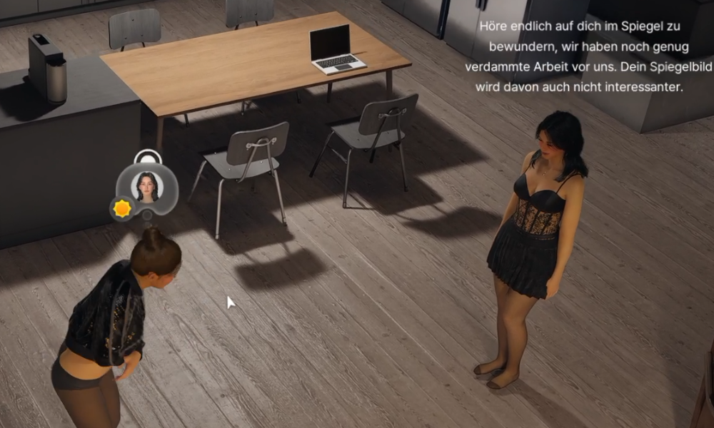
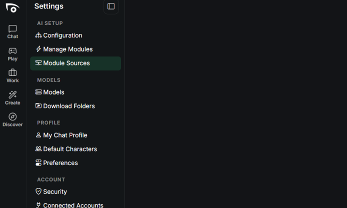
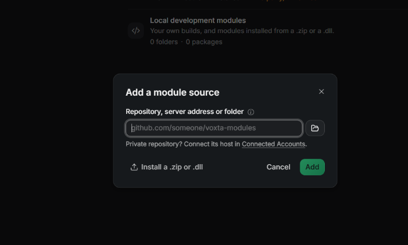
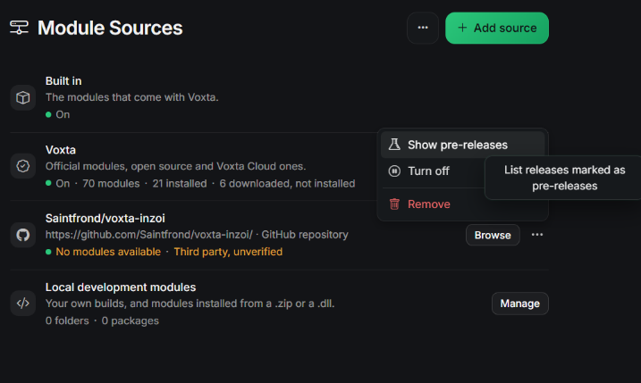
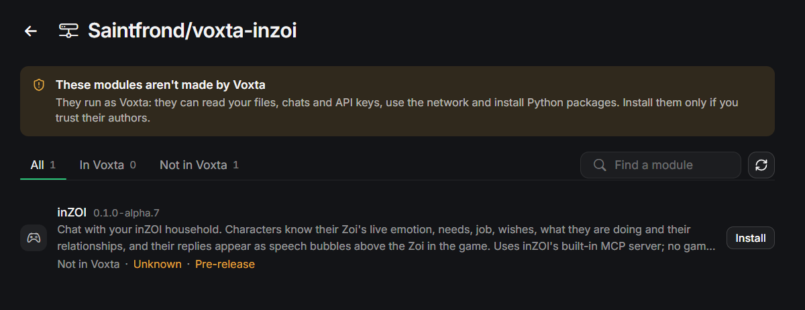
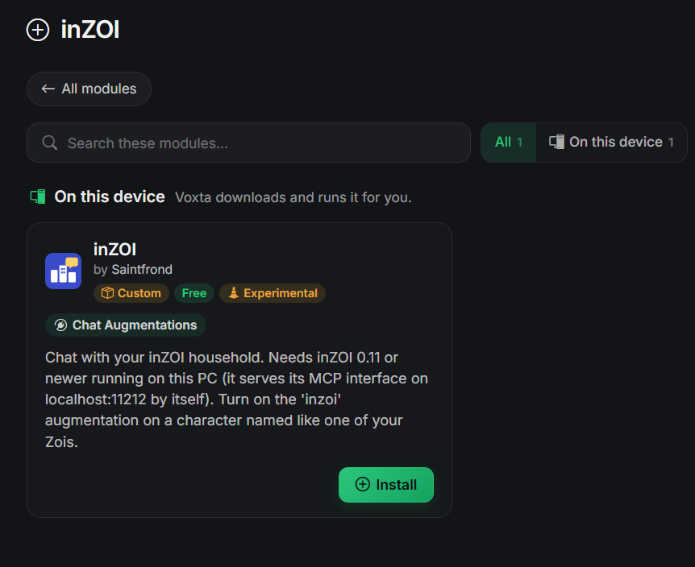
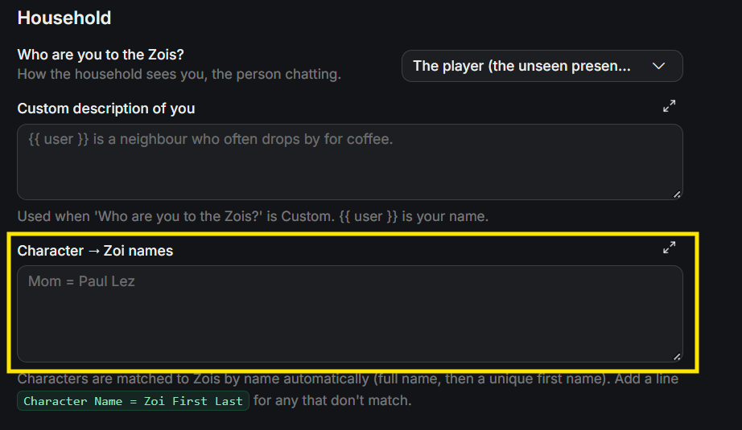
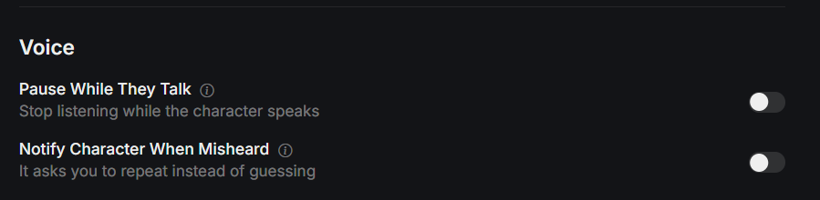

<div align="center">

# 🏡 How to use with Voxta

**Talk to your inZOI household, and let them talk back.**




<sub>A reply from Voxta, spoken and shown above the Zoi in the game.</sub>

</div>

---

## ✨ What it does

Since its latest version, inZOI has a built-in **MCP server**, so this module connects
Voxta straight to the running game.

- 💬 **Talk to one Zoi or the whole household.** They answer with voice and an in-game speech bubble.
- 🍿 **Or just watch.** Let them talk to each other while you listen in.
- 🧠 **They know their lives.** Each character knows their Zoi's live emotion, needs, job, wishes,
  what they're doing right now, and their relationships.
- 🎭 **They react in the game.** The module knows inZOI's actions and emotes, so a Zoi can laugh,
  cry, cook, clean or kiss when it happens in the chat.
- 🔄 **Install once.** New versions show up as updates inside Voxta.

---

## 📦 Installation

### 1. Add the module source

Go to **Settings → Module Sources** and click **Add source**.

<p align="center"></p>

Paste the repository link and click **Add**. The source appears in the list.

```text
https://github.com/Saintfrond/voxta-inzoi
```

<p align="center"></p>

### 2. Show pre-releases

The module is still in alpha. Open the **⋯** menu next to the new source and turn on
**Show pre-releases**.

<p align="center"></p>

### 3. Browse and install

Click **Browse**, then **Install** next to **inZOI**.

<p align="center"></p>

> [!NOTE]
> Voxta warns that third-party modules aren't made by Voxta. Trusting the repo is your call;
> Voxta runs its own security checks too. Click **Install** again on the next screen.

### 4. Add and configure

Confirm with **Add and continue**.

<p align="center"></p>

This opens the module's settings page. The options explain themselves, so adjust them to your
liking and click **Save and install**.

> [!TIP]
> **That's it.** You don't need to do anything in inZOI itself: no mod and no copied files. The
> module connects to the game's MCP server whenever the game is running.

---

## 🎮 Using the module

### Create your characters

Create a Voxta character for each Zoi you want to talk to, **named exactly like the Zoi**. That
can be one Zoi or the whole household.

> [!IMPORTANT]
> Give every one of them the **inZOI** augmentation, which the module installed. Without it, the
> character knows nothing about the game.

**Already have characters you'd like to use?** You don't have to rename them. Map them to Zois in
the module's settings under **Character → Zoi names**, one line each:

```text
Character Name = Zoi First Last
```

<p align="center"></p>

### Keep the profiles simple

Voxta reads most of what a character needs from the game, so keep the profile and scenario light.
A short personality is enough to steer them, plus a line that tells them what they are:

```text
{{ char }} knows she's an inZOI Zoi and that {{ user }} is the watcher who guides her life.
She finds this mildly outrageous and enjoys giving {{ user }} a piece of her mind about the
choices made for her, but deep down she's glad someone is paying attention.
```

For a scenario, add the characters to their roles and describe the household in a sentence or two:

```text
{{ scenario_chars.juve }} and {{ scenario_chars.paula }} are two women living together in a
house. They live a calm life together, enjoying each other's company.
```

### Start playing

1. Start **inZOI** and load your household.
2. In Voxta, start a chat with your character or scenario.

---

## 🍿 Tip: let them talk to each other

Make a scenario with your household members and set its chat flow to **Story**. The Zois then
talk among themselves, and you can still jump in.

To talk over them, turn off **Pause While They Talk** in Voxta's **Preferences → Voice**.

<p align="center"></p>

---

<details>
<summary><b>🛠️ Something not working?</b></summary>

<br>

- **The character doesn't know anything about the game.** Check that inZOI (0.11 or newer) is
  running and that the character has the **inZOI** augmentation.
- **The character doesn't know which Zoi they are.** The name doesn't match. Add a line under
  **Character → Zoi names**.
- **Nothing happens in the game.** Check that `http://localhost:11212/mcp` is reachable. If you
  start inZOI with `-climcpport=<port>`, set the same port in the module.

More detail is in the main [README](README.md).

</details>

<div align="center">
<sub>Not affiliated with or endorsed by KRAFTON or inZOI Studio. inZOI is a trademark of KRAFTON, Inc.</sub>
</div>
